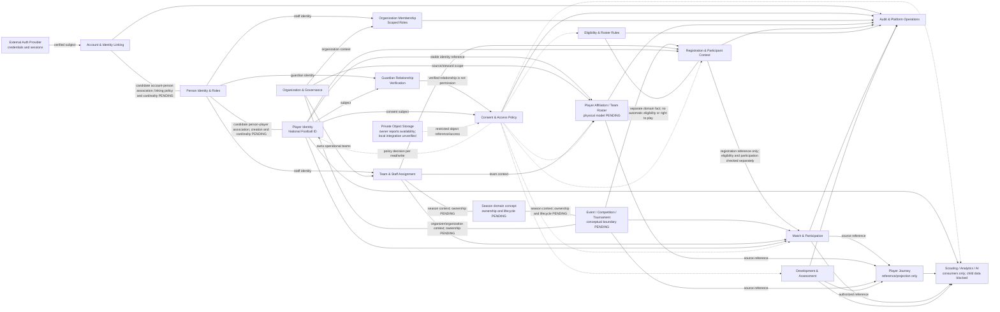

# Phase 0.7 — Domain Context Map

**Status:** Conceptual planning view only. No schema/API boundary is approved by this diagram. It preserves ADR-09–12 and DECISION-001/002/003. Any unresolved ownership or integration choice is listed in [phase-0.7-unresolved-decisions.md](phase-0.7-unresolved-decisions.md).

## Context map

## Context boundaries

| Context | Upstream inputs | Downstream consumers | Boundary rule |
|---|---|---|---|
| Account & Identity Linking | Auth provider subject/claims | Person Identity; server authorization | Login identity is separate from person/player identity. Account-person verification, linking policy, cardinality, recovery, and resolution rules remain PENDING. |
| Person Identity & Roles | Candidate account-person association; identity verification workflow (details PENDING) | Player, Guardian, Organization membership and staff assignments | One person may have multiple roles; role labels alone do not authorize actions, and a person does not automatically become a player. Account-person verification, linking, cardinality, recovery, and resolution remain PENDING. |
| Player Identity | Candidate person association; identity creation/correction workflow | Affiliations, competitions, match, journey, development | National Football ID belongs to Player Identity; it is stable, cannot be transferred or reused, and is never organization-owned or recreated by transfer. Person-to-player creation, cardinality, duplicate resolution, merge, and split remain unresolved (D-33 PENDING). |
| Guardian Relationship & Consent | Guardian/player identities, verification and grant events | Source-domain authorization decisions | Relationship verification and consent are separate; default deny. A verified guardian relationship does not establish unlimited authority; grantor authority is scoped and policy-dependent. |
| Organization & Governance | Person memberships, organization verification and hierarchy | Teams, competition organizer assignments, affiliation stewardship | A hierarchy or organization membership does not automatically grant access to other organizations or full player history. Organization Owner is not global platform admin authority. |
| Team & Staff Assignment | Organization and person/team assignment | Roster, schedule, attendance, match/competition operations | Staff authority requires current exact-scope assignment; writes and revocation need audit. |
| Player Affiliation / Roster | Player identity, organization, team/season | Team lists, operational context, journey references | Player affiliation and team roster retain distinct domain meanings. Whether represented by one or two physical relations remains PENDING (P-08/P-09). |
| Event / Competition / Tournament | Organizer/organization context, schedule, categories and teams | Registration, match schedule/results, journey | Event, competition, and tournament are distinct conceptual meanings; the exact ownership of events, competition lifecycle, registration, and schedule remains unresolved (D-34 PENDING). |
| Registration | Player/team/competition context | Event registration views and match participant references | Records registration context only; it does not create identity, establish eligibility, confer a right to play, or imply consent to unrelated historical data. Eligibility, roster, registration, and participation remain separate facts. Lifecycle and payment rules remain PENDING. |
| Season | Team/competition context and validity windows | Roster, registration, eligibility and schedule boundaries | Season is a domain concept, not simply a team label. Its ownership, lifecycle, and relationship to teams and events remain unresolved (D-35 PENDING). |
| Eligibility & Roster Rules | Player/team/competition conditions | Eligibility evaluation, registration checks, match participation checks and audit | Eligibility, team roster, competition registration, and actual match participation are distinct domain facts; none automatically establishes another (D-36 PENDING). |
| Match & Participation | Competition, teams, player identity, officials and registration context | Match views, journey, development evidence, analytics | Registration context is not proof of eligibility or a right to play. Match domain owns actual participation and official facts; consumers reference them and cannot silently rewrite them. |
| Player Journey | Authorized source-domain references and provenance | Player-facing views, authorized consumer projections | Aggregation only; not a duplicate source of truth and not an authorization grant. Preserve provenance and audit minimization; retention/deletion remain unresolved. |
| Development & Assessment | Player identity, assigned coach/reviewer, source evidence | Player/guardian views under policy; journey references; derived consumers | Assessment authorship, independent verification and immutable revisions follow ADR-09. Raw observation visibility remains P-16. |
| Audit & Platform Operations | Security-relevant actor/action/decision events | Restricted compliance/security review | Least privilege and approved retention; audit is not a bypass for access policy. |
| Scouting / Analytics / AI | Approved, minimized, authorized projections | Opportunity/insight outputs | Consumer-only. No real-child search/sharing during initial development/testing; no source fact mutation. |
| Object Storage | Approved file references and upload/download authorization | Private document consumers | Owner reports Storage availability; repository integration, bucket policy and object lifecycle are unverified. |

## Key flows and invariants

1. `Auth subject → candidate account-person association → person` proves login control only; verification, linking, cardinality, recovery, and account-person resolution remain PENDING, and the association does not create or imply a player identity.
2. `Person ↔ Player Identity → National Football ID` is a candidate identity relationship, not an automatic conversion. Player creation, cardinality, duplicate resolution, merge, and split remain unresolved (D-33 PENDING). The National Football ID belongs to Player Identity and cannot be transferred or reused; transfers and registrations reference it without replacing it.
3. `Player affiliation` and `team roster` are distinct but related domain concepts. Whether they use one or two physical relations remains unresolved (P-08/P-09 PENDING).
4. `Event / Competition / Tournament → registration reference → match participation` carries context without asserting eligibility or a right to play; eligibility and actual participation are checked separately. Their boundary remains unresolved (D-34 PENDING).
5. `Season` is a domain concept associated contextually with team, competition, and participation windows; the map does not assert parent-child direction or ownership. Its ownership, lifecycle, and relationships remain unresolved (D-35 PENDING).
6. `Eligibility + Team Roster + Competition Registration + Actual Match Participation` are four distinct domain facts. Registration does not automatically establish eligibility or a right to play; their rules remain unresolved (D-36 PENDING).
7. `Source record → Journey reference` preserves source ownership, provenance, verification and authorization boundaries.
8. `Guardian relationship + independent current scoped consent + policy` is required before any permitted guardian projection; a relationship alone is insufficient, and grantor authority remains scoped and policy-dependent.
9. `Current assignment + role + scope + action + classification` is checked server-side for staff operations; client-selected role or IDs confer no authority.

## Evidence boundaries

- **Owner-reported:** the Supabase project exists, is fresh/no application schema, and Auth, Storage, and Edge Functions are configured. This was supplied in the current owner context; not independently verified.
- **Repository-observed:** no Supabase SDK, schema/migrations, generated DB types, application Auth/Storage integration, or Edge Function invocations are present in this checkout.
- **Remote evidence:** none obtained in this planning task. The context map does not prove that the configured Supabase project is used by this application.

This map does not select a provider, physical data model, or Phase 1 scope.
D-33, D-34, D-35, and D-36 remain PENDING.
