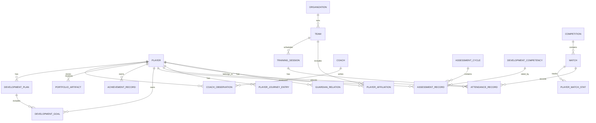

# Player Development Data Model

## Purpose

This document provides the conceptual data model for the Player Development Ecosystem while respecting the existing application architecture and repository boundary.

It does not replace the current backend schema or introduce migrations. It defines the data structure the app should aim to support as the ecosystem expands.

## Conceptual entities

### Core entities

- Player
- Guardian
- Organization
- Team
- Competition
- Match
- TrainingSession
- AttendanceRecord
- DevelopmentCompetency
- AssessmentCycle
- AssessmentRecord
- CoachObservation
- DevelopmentGoal
- DevelopmentPlan
- AchievementRecord
- PlayerJourneyEntry
- PortfolioArtifact

## Entity relationships

### Player
A Player belongs to one core identity record and may have multiple affiliations over time.

Fields (conceptual):

- id
- footballId
- firstName
- lastName
- displayName
- dateOfBirth
- gender
- dominantFoot
- preferredPositions
- status
- consentState
- createdAt
- updatedAt

### Guardian
A Guardian is connected to a Player through a separately verifiable relationship. That relationship does not itself grant access; consent grants are independent and scoped (ADR-11).

- id
- identityId
- createdAt
- updatedAt

### GuardianRelationship
- id
- guardianIdentityId
- playerId
- relationshipType
- verificationStatus
- verifiedBy
- verifiedAt
- endedAt

### ConsentGrant
- id
- guardianRelationshipId
- playerId
- dataCategories
- allowedActions
- purpose
- status (requested / active / revoked / expired / suspended)
- effectiveFrom
- expiresAt
- grantedBy
- version
- createdAt

Consent grants are independent per guardian. Adult transition suspends guardian grants pending explicit player authorization; age thresholds and legal process are deployment policy.

### Organization
An Organization is an academy, club, SSB, or association context.

- id
- name
- type
- verificationStatus
- createdAt

### Team
A Team belongs to an Organization and has membership across seasons.

- id
- organizationId
- name
- ageGroup
- season
- status

### PlayerAffiliation
A dated relationship between a global player identity and an organization and, optionally, a team. It is not the player identity itself. Multiple active affiliations are allowed.

- id
- playerId
- organizationId
- teamId (optional)
- role
- status
- effectiveFrom
- effectiveTo
- recordedBy
- sourceOrganizationId
- createdAt
- endedAt
- endReason

### PrimaryContextPreference
An optional player-selected presentation preference, constrained to an active affiliation. It does not confer ownership or access. If that affiliation ends, the preference becomes unset rather than silently selecting another organization.

- playerId
- primaryOrganizationAffiliationId (optional)
- primaryTeamAffiliationId (optional)
- selectedBy
- updatedAt

### TrainingSession
Training sessions are operational records generated by the Training domain.

- id
- organizationId
- teamId
- coachId
- sessionDate
- objectiveIds
- durationMinutes
- location
- status

### AttendanceRecord
Attendance connects a player to a training or match event.

- id
- playerId
- sessionId or matchId
- eventType
- status
- reasonCode
- recordedBy
- createdAt
- verifiedAt

### DevelopmentCompetency
Formal competency taxonomy used across all development assessments.

- id
- domainType (technical/tactical/physical/psychological)
- code
- name
- description
- rubricScale

### AssessmentCycle
A time-bounded evaluation period.

- id
- playerId
- cycleType
- startDate
- endDate
- createdBy
- status

### AssessmentRecord
Formal assessment result tied to a competency or group of competencies.

- id
- assessmentCycleId
- playerId
- competencyId
- score
- scale
- evidenceRefs
- assessorId
- organizationId
- revisionNumber
- supersedesAssessmentRecordId (optional)
- status
- createdAt
- verifiedAt
- verifierId
- disputeStatus
- auditRefs

Verified assessment versions are immutable. Disputes and corrections create auditable review/revision records; prior versions are retained. Assessment entities are future scope and are not part of Phase 1 implementation.

### CoachObservation
Narrative performance or development observation.

- id
- playerId
- observerId
- sessionId or matchId
- observationType
- summary
- evidenceRefs
- status
- createdAt

### DevelopmentGoal
Player or coach-created goal.

- id
- playerId
- creatorId
- competencyId
- targetState
- dueDate
- status
- createdAt
- revisionHistory

### DevelopmentPlan
A collection of goals and recommended development actions.

- id
- playerId
- ownerId
- period
- goals
- status

### AchievementRecord
Performance achievement or award.

- id
- playerId
- title
- sourceType (competition / training / assessment)
- sourceId
- verified
- year
- createdAt

### PlayerJourneyEntry
Timeline event referencing authoritative records.

- id
- playerId
- eventType
- date
- sourceDomain
- sourceId
- summary
- verificationStatus
- relatedEntityIds

### PortfolioArtifact
Player-submitted or verified artifact in the portfolio.

- id
- playerId
- artifactType
- title
- URL or record reference
- verified
- uploadedBy

## Aggregate boundaries

### Player aggregate
- Player
- Guardian relationships
- affiliations
- profile verification

### Journey aggregate
- Journey entries
- milestones
- portfolio references

### Training aggregate
- TrainingSession
- TrainingPlan
- objectives
- attendance evidence

### Development aggregate
- Competency framework
- Assessment cycle
- Assessment records
- Goals and plans

### Match aggregate
- match record
- participation and performance stats

## Mermaid ERD

## Data ownership summary

- Player identity is owned by the Player Identity & Profile domain.
- Training events are owned by the Training domain.
- Match facts are owned by the Match & Performance domain.
- Attendance is owned by the Attendance domain.
- Development competency assessments are owned by the Development & Assessment domain.
- Journey data is an aggregate view, not an independent source.
- Global player identity is not organization-owned. Affiliation facts retain their organization/team provenance; primary context is a player preference only.
- Guardian relationships and consent grants are separate concepts; neither grants access outside the approved scope.
- Cross-organization sharing references source records under explicit grants; exports are non-authoritative copies.

## Versioning and audit requirements

Conceptual requirements for future implementation:

- create and update timestamps
- createdBy and updatedBy references
- verificationStatus
- recordVersion
- historical snapshot tables or event logs
- soft delete / archive rules for invalidated records

## Risk areas

- Duplicate player records across organizations
- Unclear owner between informal observations and formal assessments
- Event data being treated as source data instead of evidence
- Summaries being mistaken for record-level truth

## Decision summary

The data model is intentionally reference-based and event-aware rather than duplicated. It ensures that a player's development history remains continuous while preserving authoritative ownership at the source domain.
