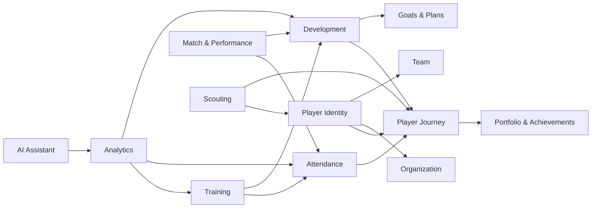

# Player Development Domain Map

## Scope

This document maps the Player Development Ecosystem into bounded domains and tracks the current implementation status against the approved architecture.

## Domain ownership map

| Domain | Primary owner | Source of truth | Consumers | Existing implementation status | Architectural notes |
| --- | --- | --- | --- | --- | --- |
| Player Identity & Profile | Core platform + player domain | Global player record + Football ID; affiliations are separate scoped relationships | Player, guardian, org, coach, future intelligence | Implemented as current identity and player flows | Identity is never owned by a single organization; see ADR-10 |
| Player Journey | Player journey domain | Timeline references and journey-only narrative | All player-facing roles | Partially present in journey data and profile views | Must aggregate source records, not duplicate them; cross-org sharing is explicit, see ADR-12 |
| Training Ecosystem | Training domain | Training sessions, objectives, assignments | Coach, org, player, guardian | Placeholder / future module | Must remain a source domain for training events only |
| Attendance & Participation | Attendance domain | Training attendance, availability, participation outcomes | Coach, org, player, guardian | Placeholder / future module | Must not become a second player record store |
| Development & Assessment | Development domain | Competency ratings, evaluation cycles, evidence | Coach, player, guardian, org | Placeholder / future module | Formal assessments must be evidence-based and traceable |
| Coach Observation & Feedback | Coach workflow | observation notes, coaching feedback | Coach, player, org | Placeholder / future module | Informal notes are not the same as formal assessment |
| Match & Performance Integration | Competition/match domain | match statistics, lineups, participation, performance data | Coach, player, org, scouting | Existing and aligned | Match remains authoritative owner of match facts |
| Player Goals & Development Plans | Development planning domain | goal definitions, checkpoints, revisions | Coach, player, guardian | Placeholder / future module | Goals must be tied to competencies and evidence |
| Player Portfolio & Achievements | Portfolio domain | verified awards, milestones, competition history | Player, org, scouting | Partially present as achievement data | Must distinguish verified from submitted data |
| Scouting & Opportunities | Consumer domain | scout notes and opportunity records | Scout, org, player | Placeholder / future module | Must not own player record or assessment source data |
| Analytics & AI Development Intelligence | Consumer domain | derived insights and recommendations | Org, coach, player, AI | Placeholder / future module | Must remain downstream and non-authoritative |

## Bounded contexts

### 1. Player Identity Context
Owns core identity, player record, and relationship metadata.

### 2. Player Journey Context
Owns the timeline and historical narrative of the player's football story.

### 3. Training Operations Context
Owns training delivery, planning, and objective assignment.

### 4. Participation Context
Owns attendance and participation records attached to training and match events.

### 5. Development Context
Owns formal evaluation frameworks and competency measurement.

### 6. Match Performance Context
Owns match records and in-game performance facts.

### 7. Opportunity & Scouting Context
Owns opportunity workflows while consuming authorized player data.

### 8. Intelligence Context
Owns insights and recommendations, not source records.

## Dependency map

## Cross-domain constraints

- Training does not own player development assessments.
- Attendance does not own the player's journey narrative.
- Match does not own training or coaching feedback.
- Player Journey aggregates details from other domains instead of duplicating them.
- Scouting, Analytics, and AI consume authorized data and never become source domains.

## Observed repository alignment

This domain map aligns with the existing codebase structure:

- Role and context in [src/config/roles.ts](src/config/roles.ts)
- Repository boundary in [src/data/repository.ts](src/data/repository.ts)
- Player and journey data in [src/data/types.ts](src/data/types.ts) and [src/data/mock.ts](src/data/mock.ts)
- Placeholder modules in [src/config/modules.ts](src/config/modules.ts)

## Resolved architecture questions

- Global identity is independent from organization ownership. Dated organization/team affiliations can coexist; primary organization is a player-selected view context among active affiliations, not a permission grant or ownership claim (ADR-10).
- Formal assessments use separate author and verifier identities, organization-designated independent reviewers, disputes, and immutable revisions (ADR-09).
- Guardian relationship verification is separate from scoped, time-bounded consent; multiple guardians have independent grants, and minor-to-adult access is suspended pending player authorization (ADR-11).
- Cross-organization transfer preserves source records but does not automatically share historical or confidential records; the player grants scoped access (ADR-12).

Deployment-specific policy still required: applicable age/assent thresholds, guardian verification process, record retention periods, and confidentiality classification rules.

## Decision summary

The domain map follows the product principle that the player owns the longitudinal journey while organizations and coaches contribute evidence, guidance, and operational context.
