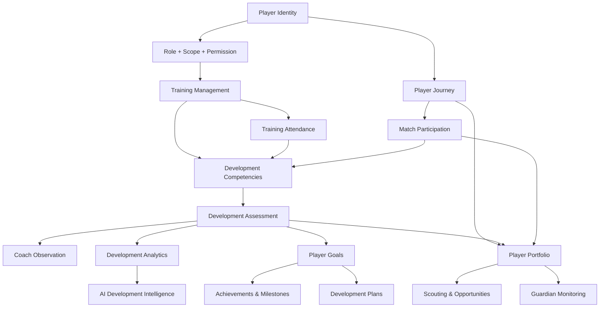

# Player Development Implementation Dependency Map

## 1. Dependency model

The implementation must respect dependency ordering. This ecosystem cannot be built as 16 disconnected modules without creating duplication and ownership drift.

## 2. Foundation dependencies

These are the non-negotiable starting blocks:

1. Player Identity & Profile
2. Player Journey
3. Role and scope permission model
4. Repository contract expansion
5. Shared dashboard shell
6. Core player profile and profile access protections

### Reason
Without these, all downstream modules would create parallel or duplicated player sources.

## 3. Core development capabilities

These modules depend directly on the foundation:

1. Training Management
2. Training Attendance
3. Match Participation
4. Development Competencies
5. Player Development Assessment
6. Coach Observation & Feedback
7. Player Goals
8. Development Plans
9. Player Portfolio
10. Achievements & Milestones

### Reason
These modules create the evidence, progression, and longitudinal context that define the player’s development story.

## 4. Supporting capabilities

These modules depend on the core features and are not source domains:

1. Guardian Monitoring
2. Scouting & Opportunities
3. Development Analytics

### Reason
They depend on consented and verified core records and should remain consumer-facing.

## 5. Advanced intelligence capabilities

1. AI Development Intelligence

### Reason
This layer depends on the full evidence model and should only be activated after source domains are stable.

## 6. Implementation sequence

### Foundation sequence
1. Player Identity & Profile
2. Player Journey
3. Role and permission-aware access model
4. Repository and UI contracts

### Core sequence
5. Training Management
6. Training Attendance
7. Match Participation
8. Development Competencies
9. Player Development Assessment
10. Coach Observation & Feedback
11. Player Goals
12. Development Plans
13. Player Portfolio
14. Achievements & Milestones

### Supporting sequence
15. Guardian Monitoring
16. Scouting & Opportunities
17. Development Analytics

### Advanced sequence
18. AI Development Intelligence

## 7. Dependency graph

## 8. Important constraints

- Do not activate a module before its source owner is clear.
- Do not build scouting or AI as parallel player sources.
- Do not design analytics or AI as the system of record.
- Preserve existing functionality and only add modules behind the approved “coming soon” pattern.

## 9. Recommended first implementation phase

The correct first implementation is Phase 1: Player Identity & Journey Foundation.

This creates the stable foundation for all later domains and preserves the product principle that the player owns the journey.
