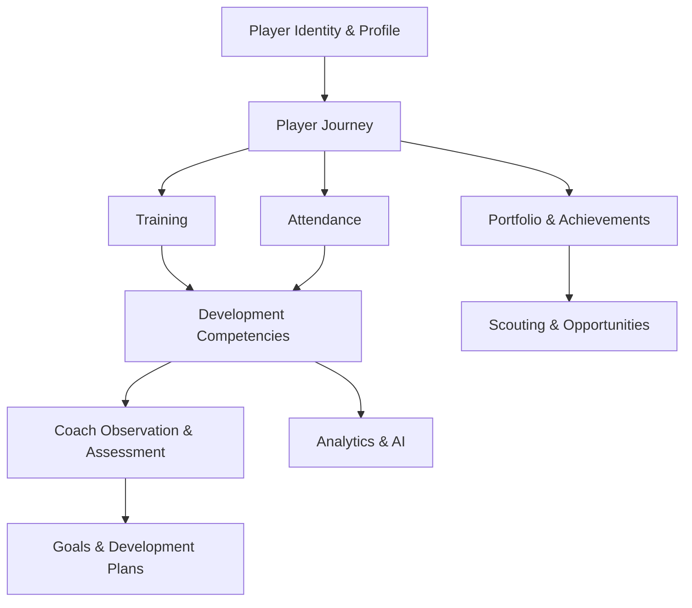

# Player Development Integration Roadmap

## Objective

This roadmap defines how the Player Development Ecosystem should be connected into the existing application without replacing current architecture or creating product silos.

## Existing architecture fit

The current app already has the following foundations:

- app shell and role-aware navigation
- player and organization domains
- competition and match data
- repository boundary pattern
- placeholder modules for future product activation

These are sufficient foundations for a disciplined rollout.

## Activation dependency model

## Phase 1 — Player Identity & Journey Foundation

Objectives:

- finalize player identity ownership
- preserve player continuity across organizations
- connect player profile to the journey timeline

Required domains:

- Player Identity & Profile
- Player Journey

Repository changes:

- add player journey selectors behind repository contracts

UI integration:

- existing player profile and journey views remain central

Acceptance criteria:

- a player retains a stable identity across team transfers
- journey entries use references to source records, not duplicate copies

## Phase 2 — Training & Attendance Integration

Objectives:

- connect training planning to player participation
- connect attendance to real session and match events

Required domains:

- Training Ecosystem
- Attendance & Participation

Acceptance criteria:

- training and attendance data are distinct but linked
- attendance remains evidence, not a final development judgment

## Phase 3 — Development Competency Framework

Objectives:

- define technical, tactical, physical, and psychological competencies
- create a measurable development rubric

Required domains:

- Development & Assessment
- Competency framework

Acceptance criteria:

- development framework is shared and reusable
- no single numerical score replaces full development context

## Phase 4 — Coach Observation & Assessment

Objectives:

- enable coach observations and formal assessments
- separate informal notes from verified development records

Required domains:

- Coach Observation & Feedback
- Development & Assessment

Acceptance criteria:

- observation is not automatically an official assessment
- verification workflow is explicit

## Phase 5 — Goals & Development Plans

Objectives:

- create player-centered goal tracking
- connect goals to competency evidence and assessed progress

Required domains:

- Player Goals & Development Plans

Acceptance criteria:

- goals are measurable
- revisions are recorded and traceable

## Phase 6 — Match Performance Integration

Objectives:

- connect player performance to match facts and showcase development evidence

Required domains:

- Match & Performance Integration

Acceptance criteria:

- match records remain authoritative in match context
- performance evidence is connected to player development without duplication

## Phase 7 — Portfolio & Achievements

Objectives:

- create a verified performance portfolio
- preserve historical milestones and achievements

Required domains:

- Player Portfolio & Achievements

Acceptance criteria:

- verified records and player-submitted records are clearly separated

## Phase 8 — Scouting & Opportunities

Objectives:

- create opportunity workflows using authorized player data
- keep scouting from owning the source data

Required domains:

- Scouting & Opportunities

Acceptance criteria:

- scout workflows consume authorized context only
- source data remains in the player and journey domains

## Phase 9 — Analytics & AI Development Intelligence

Objectives:

- provide insight generation from authorized data
- preserve distinction between insight and official assessment

Required domains:

- Analytics & AI Development Intelligence

Acceptance criteria:

- insight generation is derived only
- AI recommendations are clearly labeled as recommendations, not official decisions

## Activation criteria for future modules

A module should only become active when:

- owner domain is identified
- source-of-truth is defined
- repository contract is in place
- authorization model is explicit
- acceptance criteria are clear
- the UI is connected to existing architecture rather than acting as a stand-alone app

## Recommended next task

The next implementation work should be a blueprint for Player Development Ecosystem activation, not a direct build. The separate blueprint and implementation plan should be approved before any new feature work begins.
